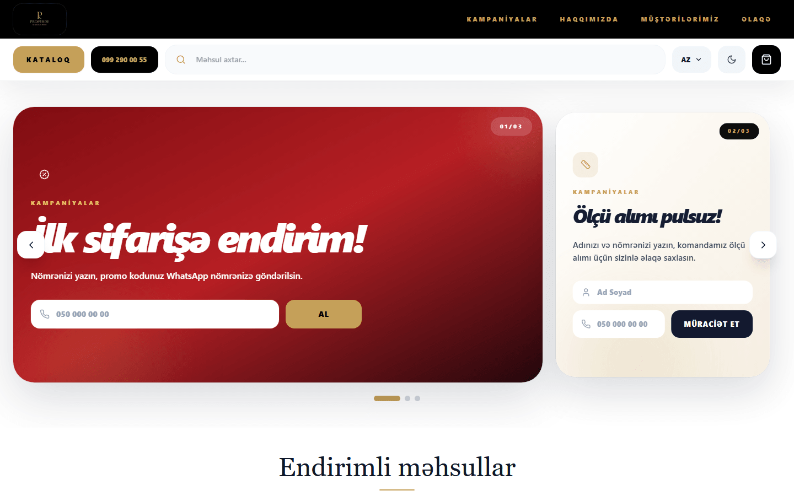

# Perde.az: curtain shop frontend

[](https://codelady-ship.github.io/Curtain-shop-web-site-frontend/)
[](https://github.com/codelady-ship/Curtain-shop-web-site-frontend/actions/workflows/pages.yml)

> AZ: Pərdə, tül və jalüz mağazası üçün React kataloq və admin panel. GitHub Pages versiyası backend olmadan demo məlumatlarla işləyir.

React + Vite storefront for a curtain shop: a product catalog with filters, product pages with colour and size options, a basket and wishlist, lead and order forms, and an admin panel. The API is a separate Spring Boot service: [Curtain-shop-web-site-backend](https://github.com/codelady-ship/Curtain-shop-web-site-backend).

**Live demo:** https://codelady-ship.github.io/Curtain-shop-web-site-frontend/



## Demo mode (GitHub Pages)

The Pages build runs **without a backend**:

- products come from `src/store/productData.json`, with search, filters, sorting and paging done in the browser;
- campaign banners and partners use the built-in fallbacks;
- lead and order forms show a clear "Demo" confirmation and send nothing;
- the admin login says it needs the backend;
- no request goes to `/api`, so the console has no failing network calls.

## Features

- Catalog with search, category and room filters, sorting and pagination
- Product page with colour swatches, size and price options, and similar products
- Basket and wishlist kept in the browser, plus an order request form
- Campaign slider with lead forms (promo code, free measurement, room photo upload)
- AZ / RU / EN interface and light / dark theme
- Admin panel (with the backend): products, banners, partners, leads and visitor stats
- SEO: per-page title, description, canonical and Open Graph tags (react-helmet-async), `robots.txt` and a generated `sitemap.xml`

## Tech stack

React 18, Vite 7, React Router 6, Tailwind CSS 3, Framer Motion, Axios, Zustand, Recharts, lucide-react, react-helmet-async.

## Run locally

```bash
npm ci
npm start            # http://localhost:3000, /api is proxied to http://127.0.0.1:8080
```

Start the backend first (see its README) to get real data and the admin panel. To try the demo build instead:

```bash
npm run build:pages
npx vite preview --mode pages   # http://localhost:4173/Curtain-shop-web-site-frontend/
```

## Build against a real API

Vite reads `VITE_*` variables at build time. Copy `.env.example` to `.env.production.local` (git-ignored):

```bash
VITE_API_BASE_URL=https://curtain-shop-api.onrender.com     # /api is appended if missing
VITE_BACKEND_ORIGIN=https://curtain-shop-api.onrender.com   # for /uploads/... image URLs
VITE_SITE_URL=https://your-domain.example                    # canonical / Open Graph base, optional
```

```bash
npm ci
npm run build        # dist/ with base "/", no demo fallback; serve it with nginx.conf or any static host
```

The backend must allow your site's origin in `CORS_ALLOWED_ORIGINS`.

To point the **Pages** site at a running API, add the same two lines (`VITE_API_BASE_URL`, `VITE_BACKEND_ORIGIN`) to the committed `.env.pages` and push to `main`. These URLs are public, and the workflow builds from the repo. For a local test only, use `.env.pages.local`. The site then shows real data and only falls back to the demo products if the API cannot be reached. A free Render service can take up to about a minute to wake up.

| Variable | Used for | Default |
| --- | --- | --- |
| `VITE_API_BASE_URL` | Axios base URL | `/api` |
| `VITE_BACKEND_ORIGIN` | Absolute URLs for uploaded images | same origin |
| `VITE_DEMO_FALLBACK` | `true` only in `.env.pages` (demo build) | unset |
| `VITE_SITE_URL` | Canonical and Open Graph links | the Pages URL |

## Deploy

GitHub Pages is deployed by [`.github/workflows/pages.yml`](.github/workflows/pages.yml). On every push to `main` it runs `npm ci && npm run build:pages` and publishes `dist/` to the `gh-pages` branch. Pull requests only run the build.

`npm run build:pages` = `vite build --mode pages` (base `/Curtain-shop-web-site-frontend/`, set in `vite.config.js`) followed by `scripts/pages-postbuild.mjs`. The script writes `404.html` for client-side routes, an `index.html` copy per route so deep links return HTTP 200, and `sitemap.xml`.

## What I learned

- Making one codebase build two ways: a static demo for GitHub Pages and a real build that talks to a Spring Boot API, switched by Vite modes and env files.
- Handling a missing backend gracefully, so a portfolio demo never shows broken forms or failing requests.
- Base-path problems on GitHub Pages (`import.meta.env.BASE_URL`, `%BASE_URL%` in `index.html`, router `basename`) and making deep links work without server rewrites.
- SEO in a single-page app: per-route meta with react-helmet-async, canonical URLs and a generated sitemap.
